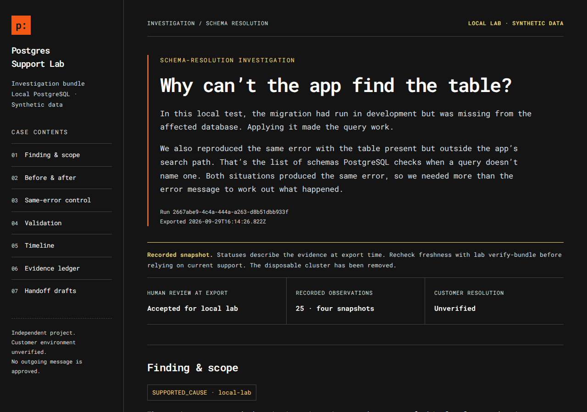

# Postgres Support Lab

Postgres Support Lab helps developers and support engineers investigate PostgreSQL problems by reproducing failures locally, checking possible causes, and drafting a customer reply from the results.

"The migration worked, but the app still says the table doesn't exist." Where do you start? The lab helps you work out what to check, shows what changed after a fix in a local test, and keeps a record of the evidence behind your explanation.

The current labs cover missing-table errors, prepared statements failing through PgBouncer, a slow query that needs an index, a client that doesn't trust the database's certificate, a table the app can find but not read, and requests that time out because the app never returned some connections to its pool. They use temporary local databases and synthetic data. Each lab covers one scoped case so far, and version one still has work left (see [What works and what's next](#what-works-and-whats-next)).

This is an independent project. PlanetScale Postgres is the first platform it plans to support, and nothing here needs a PlanetScale account.

## Quick start

You need Node.js 24 or later. This first step doesn't need a database.

```sh
npm ci
npm run demo
```

`demo` reads a made-up support ticket and lists the evidence you'd still need before explaining it. Here's the start of the output:

```text
# Evidence gap report

Status: EVIDENCE_REQUIRED
Issue family: schema-resolution

## target identity

A successful migration may have targeted another environment.

Collect: Compare the sanitized application target with the platform branch identifier. Exclude connection URIs.

Follow-up: Which branch handled the failed request, and how did you verify that target?
```

The full report covers six things to check: which database handled the request, the role and search path, whether the table exists, permissions, migration history, and the failing query itself.

To run the real PostgreSQL and PgBouncer labs, see [Run the PostgreSQL lab](#run-the-postgresql-lab) and [Try the PgBouncer experiment](#try-the-pgbouncer-experiment) below.

## See a finished investigation

[`examples/schema-case/`](examples/schema-case/README.md) is a complete support bundle from a real local run, reviewed by a person. The verifier checks the files against the manifest and recorded evidence. To check that the whole bundle still matches the copy you originally trusted, also provide its separately saved manifest hash. Each example README includes that hash.

- [Customer reply draft](examples/schema-case/bundle/customer-reply.md)
- [Engineering handoff draft](examples/schema-case/bundle/engineering-escalation.md)
- [How it was made, and how to check it](examples/schema-case/README.md)

The lab took four snapshots of the same query. In the affected database it failed with `42P01` ("relation does not exist") because the migration was missing. In a separate control database, the table existed but sat outside the search path, and the query failed with the same error. That's why the error message alone can't tell you which problem you have. After the migration was applied, the query worked, and the database, role, connection and search path hadn't changed.



This screenshot comes from the [restyled copy](examples/schema-case/README.md#restyled-copy) of the example, which uses the current report design. The evidence and review are the same.

## The PgBouncer lab

[`examples/pooling-run/`](examples/pooling-run/README.md) is a real run that follows a SQL `PREPARE` statement from one transaction to the next, first on a direct connection and then through PgBouncer in transaction mode. In that mode each transaction can run on a different PostgreSQL server connection.

| Check | Error code |
|---|---|
| Direct: run the statement in the next transaction | none |
| Through PgBouncer: run it after switching to another server connection | `26000` |
| Direct, after clearing the statement with `DEALLOCATE ALL` | `26000` |
| Through PgBouncer: prepare, run and remove it in one transaction | none |
| Driver prepared statement after switching server connections | none |
| Direct, with a deliberate statement timeout | `57014` |

Clearing the statement on a direct connection gives the same `26000` with no pooler involved, so the error code alone doesn't prove PgBouncer is the cause.

A reviewer then makes two separate decisions: whether the evidence supports the local explanation, and which fix the validation should check. [`examples/pooling-case/`](examples/pooling-case/README.md) is a reviewed and verified bundle from a real run, with its customer reply and engineering handoff.

## What works and what's next

This is a working checkpoint. All six labs now have one working, scoped case each, with review, a local check of the fix and export. Version one isn't finished yet: each lab still has cases to add, and the shared work below remains.

**Working today**

- A structured or guided intake that lists missing evidence. You can answer "unknown" to anything you don't know yet.
- An append-only evidence record with sources, scope, expiry times, corrections and hash checks.
- A local PostgreSQL lab that reproduces a missing migration, with a control that produces the same error for a different reason.
- A comparison, a recorded human review, a local check of the fix and a support bundle you can verify, for that schema case.
- A local PgBouncer lab with measured server-connection switches, controls and two possible fixes, plus separate cause and fix decisions, a local check and a verifiable bundle.
- A local slow-query lab that compares query plans and shared-block counts before and after an index, with statistics, repeated-run and selectivity controls, separate cause and fix decisions, a local check and a verifiable bundle.
- A local connectivity lab with temporary certificates that records where each connection stops: parsing, TCP, TLS verification, authentication or the query. It reproduces an untrusted-CA failure and its fix, with host-name, driver `sslmode`, server-refusal, credential, password-encoding and closed-port controls, separate cause and fix decisions, a local check and a verifiable bundle.
- A local permissions lab that connects as several synthetic roles to a table created after a grant on all tables, with wrong-role, schema `USAGE` and search-path controls, a measured one-table `GRANT SELECT`, separate cause and fix decisions, a local check and a verifiable bundle.
- A local pool-exhaustion lab that records each pool checkout by request, client and backend, and shows a connection leak alongside demand, slow-query, long-transaction and server-refusal controls and a release-in-`finally` fix, with separate cause and fix decisions, a local check and a verifiable bundle.
- Offline HTML and Markdown reports, and privacy checks that reject recognized sensitive patterns before anything is saved.

Everything above runs locally on synthetic data. A local result shows what can cause a problem. It doesn't confirm what happened in a customer's environment. The lab produces customer-reply drafts. It does not send them, and they still need human review before use.

**Planned for version one**

Version one includes six labs:

1. Missing tables and schema drift between environments: working, with wrong-target and name-casing cases still to add.
2. Session behavior through PgBouncer: working, with more workflows and routing cases still to add.
3. SSL, authentication and connection-string failures: working for a client that doesn't trust the issuing CA, with client certificates and public CAs still to add.
4. Permissions and schema resolution: working for a table created after a grant on all tables, with row-level security, column privileges and inherited roles still to add.
5. Slow queries and index effectiveness: working for a missing index on a selective filter, with an unused-index case still to add.
6. Application pool exhaustion and connection leaks: working for a handler that keeps its client after a query error, with a leak inside an aborted transaction and an idle-in-transaction timeout control still to add.

Shared work also remains, including general comparisons, a live PlanetScale connection policy, a proper SQL parser for safety checks, broader privacy tests and a Docker setup. The [build checkpoint](docs/build-checkpoint.md) and [delivery scope](docs/delivery-scope.md) track all of it.

More: [schema explainer](docs/explainers/schema-drift.md), [PgBouncer explainer](docs/explainers/pooling-session.md), [release checklist](docs/release-checklist.md).

## Command reference

### Offline demos

```sh
npm test
npm run demo:ledger
npm run demo:evidence
```

`demo:ledger` creates a temporary practice case, records one observation and then a correction to it. It shows both records, marks the first as replaced, and checks that the original entry is still intact. The temporary case is removed afterward.

`demo:evidence` walks through how evidence adds up: an empty case, six observations, one that conflicts, a correction, and evidence that has expired. The report points to the records behind each statement and leaves the cause and resolution unset. Both demos run offline and don't touch a database.

Practice observations say where they came from, but the lab can't prove who supplied them. The local labs run fixed queries on their own temporary PostgreSQL server. A cause stays unset until a person reviews fresh local evidence and accepts it, and a customer's own environment is never marked as fixed.

### Use the guided workflow

```sh
npm run guide
```

The guide walks you through the main tasks without editing JSON or copying hashes between commands. You can record a support report and see what evidence is missing, pick a recorded lab run to review, or start a new PostgreSQL or PgBouncer lab. Optional questions accept `unknown`. Your typing is hidden while you answer, and the guide shows you the checked answers before saving anything.

A saved report waits for evidence. The labs use their own synthetic data and never connect to the environment described in a report. See the [guided workflow](docs/guided-workflow.md) for the exact steps and what happens if something goes wrong.

### Run the PostgreSQL lab

Install the PostgreSQL server tools (version 16, 17 or 18) and point the lab at their `bin` folder. On macOS with Postgres.app:

```sh
export PSLAB_PG_BIN="/Applications/Postgres.app/Contents/Versions/17/bin"
npm run demo:postgres -- --dry-run
npm run demo:postgres -- --approve-lab
```

`--dry-run` shows the plan. `--approve-lab` approves it: the lab creates a temporary database server, runs the bundled migration and queries, then shuts it down. The runner connects only to the temporary PostgreSQL server it creates, through a private Unix socket. That server's TCP listener is disabled, and the runner does not accept an external database URL.

The run records a working query in development, the `42P01` error in the affected database, and a control that hits the same error even though the migration was applied. It then applies the migration to the affected database and runs the query again. The evidence and a short report are kept in a new folder under `cases/`, and the temporary server is removed.

See the [local lab guide](docs/native-lab.md) for what the evidence covers, cleanup, and the integration test.

### Try the PgBouncer experiment

```sh
npm run demo:pooling -- --dry-run
```

The full run needs the PostgreSQL server tools and PgBouncer 1.21 or later (version 1.x). It follows a SQL `PREPARE` statement on a direct connection and through PgBouncer, reproduces the same error by clearing the statement on a direct connection, and tries two fixes. Read the [PgBouncer guide](docs/pooling-lab.md) before approving the run. Afterwards you can review, check and export it with the guided workflow or the `pooling` commands in the [PgBouncer guide](docs/pooling-lab.md#review-validate-and-export).

### Try the connectivity lab

```sh
npm run demo:connectivity -- --dry-run
```

The full run needs the PostgreSQL server tools and `openssl`. It creates temporary certificates, starts a server that accepts only TLS on `127.0.0.1`, and records where each connection attempt stops. Read the [connectivity guide](docs/connectivity-lab.md) before approving the run. Afterwards you can review, check and export it with the `connectivity` commands in that guide.

### Try the permissions lab

```sh
npm run demo:permissions -- --dry-run
```

The full run needs only the PostgreSQL server tools. It starts a server on a private Unix socket, connects as several synthetic roles and records which role, search path, catalog entry and privileges sit behind each error, before and after a one-table `GRANT SELECT`. Read the [permissions guide](docs/permissions-lab.md) before approving the run. Afterwards you can review, check and export it with the `permissions` commands in that guide.

### Try the pool-exhaustion lab

```sh
npm run demo:pool-exhaustion -- --dry-run
```

The full run needs only the PostgreSQL server tools. It starts a server on a private Unix socket and runs an in-process request handler against a small `pg` pool. It records each checkout by request, client and backend, with the pool's counters and the server's sessions, first for a handler that leaks its client when a query fails, then for its fix. Read the [pool-exhaustion guide](docs/pool-exhaustion-lab.md) before approving the run. Afterwards you can review, check and export it with the `pool-exhaustion` commands in that guide.

### Try the slow query and index lab

```sh
npm run demo:index -- --dry-run
```

The full run needs only the PostgreSQL server tools. It loads 200,000 synthetic orders, measures one customer filter before and after `ANALYZE` and before and after an index, repeats each query, and checks a common value with the index in place. Read the [slow query and index guide](docs/index-lab.md) before approving the run. Afterwards you can review, check and export it with the `index` commands in that guide.

### Compare and review a recorded schema run

Use the folder printed by the PostgreSQL lab:

```sh
node src/cli.ts lab compare RUN_DIRECTORY
node src/cli.ts lab review-template RUN_DIRECTORY > RUN_DIRECTORY/review-input.json
```

The comparison shows what changed after the migration, what stayed the same, both controls, and the evidence behind each line. Fill in the template with your name or identifier, your decision and your reasoning, then record it:

```sh
node src/cli.ts lab review RUN_DIRECTORY RUN_DIRECTORY/review-input.json
```

An accepted finding applies to the local lab only. Earlier decisions are kept, and once the evidence expires it no longer supports an acceptance. See the [comparison and review guide](docs/lab-review.md) for the full workflow and its limits.

### Export a support bundle

After accepting the local finding, check the fix and export a new bundle folder:

```sh
node src/cli.ts lab validate RUN_DIRECTORY
node src/cli.ts lab export RUN_DIRECTORY NEW_BUNDLE_DIRECTORY
node src/cli.ts lab verify-bundle NEW_BUNDLE_DIRECTORY
```

Open `support-bundle.html` in the exported folder. It brings together the comparison, the control, the review, the local check, a timeline and every evidence record. It works offline and includes its fonts. The customer reply, engineering handoff and runbook draft are in the report and as Markdown files. None of them has been approved to send, and the customer's environment is still unconfirmed.

If an investigation is incomplete or its evidence has expired, add `--gaps-only` to `lab export`. The [support bundle guide](docs/support-bundle.md) covers the file list, verification, evidence expiry and what's safe to share.

`lab restyle-bundle` gives an existing bundle the current design while keeping its original evidence and export time. See the [restyling instructions](docs/support-bundle.md#restyle-an-existing-bundle) and the [design guide](docs/design-system.md).

### Record a practice case

The [evidence record guide](docs/evidence-ledger.md) explains the fields, what the hashes can and can't prove, and the workflow:

```sh
node src/cli.ts ledger init CASE_DIRECTORY CASE_CONFIG.json
node src/cli.ts ledger append CASE_DIRECTORY OBSERVATION.json
node src/cli.ts ledger inspect CASE_DIRECTORY
node src/cli.ts ledger gaps CASE_DIRECTORY --json
```

`ledger gaps` needs a version-two practice case or a version-three lab case with its intake attached. See the [evidence contract guide](docs/evidence-contract.md) for the six kinds of observation and how coverage works. `ledger inspect` still reads version-one cases.

Add `--dry-run` to the end of a command to see whether it would write anything. Case folders must be new, and their parent folder must already exist. Keep working cases in the `cases/` folder, which Git ignores. For a first try without preparing any JSON, use `npm run demo:ledger`.

## Safety and limits

The evidence record accepts synthetic practice data and local lab results only. The labs run fixed queries on their own temporary servers; you can't give them a connection URL or your own SQL. The privacy checks catch common patterns but miss some and occasionally block harmless text. They can't recognize every name, address or secret, so use synthetic input and read it yourself before saving.

The hashes check that records haven't changed since they were written. Anyone who controls the files could rewrite the records and recompute every hash, so keep a copy of an important hash somewhere else if you need to check it later. A successful local test needs its own evidence from the customer's environment before anyone can say the customer's problem is fixed.

TypeScript runs through Node's built-in type stripping, and static type checking isn't set up yet. Package publishing to npm is turned off.

## License

The project's code is released under the [MIT License](LICENSE). The Roboto Mono and Inter fonts embedded in the HTML reports keep their own SIL Open Font License notices, in `docs/roboto-mono-LICENSE.txt` and `docs/inter-LICENSE.txt`.
