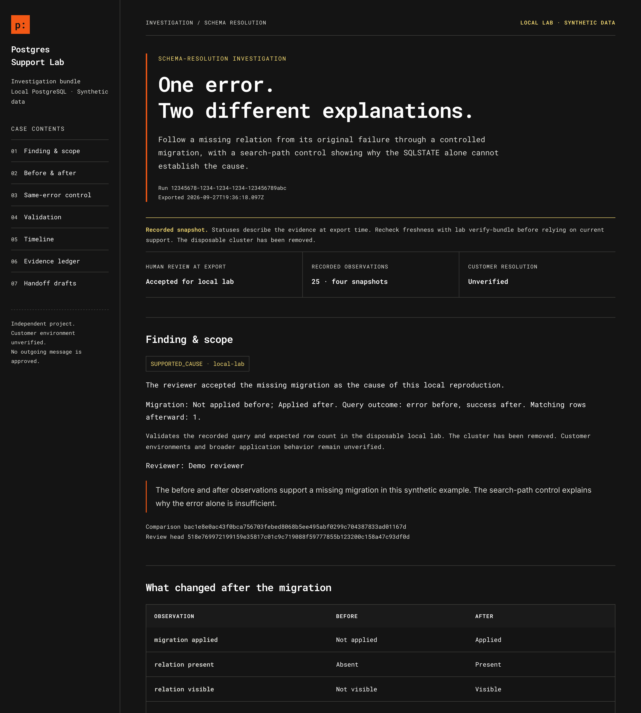

# Postgres Support Lab design

Signal is the shared visual design for the lab's HTML investigation report and its document views. The design takes its dark technical look from PlanetScale's public website, with its own distinct `p:` wordmark, numbered case navigation and evidence-focused report structure.

Static layout preview using simulated test evidence. This image demonstrates presentation; it is not a measured PostgreSQL run.

## Palette

| Token | Value | Use |
|---|---|---|
| Canvas | `#141414` | Main background |
| Surface | `#1a1a1a` | Code blocks and table headings |
| Text | `#ffffff` | Primary reading text |
| Muted | `#deded8` | Metadata and secondary labels |
| Rule | `#41413e` | Hairline borders and separators |
| Orange | `#f35815` | Wordmark and structural accents |
| Yellow | `#f4da72` | Snapshot notices and keyboard focus |
| Link | `#a7d4ef` | Evidence references and navigation links |

PlanetScale's [published brand guide](https://planetscale.com/brand), inspected on 27 September 2026, specifies black `#1a1a1a`, white `#fafafa` and orange `#f35815`, with Inter and Roboto Mono. The yellow and link colours above are this project's choices informed by the supplied screenshots. These tokens are not a claim to reproduce every computed style on PlanetScale's live website.

Orange carries short accents; long text uses high-contrast neutral colours. Status labels always include words. Sharp borders, spacing and type establish hierarchy. Components use no gradients or rounded dashboard cards.

## Typography and offline use

Roboto Mono 400 and 600 carry navigation, report headings, observations and technical metadata. Inter 400 and 600 carry longer handoff drafts and reviewer prose. The font files are embedded as WOFF2 data URLs, so opening the HTML does not request a font from a third party. System fallback stacks cover missing glyphs.

Unmodified Latin font files come from `@fontsource/roboto-mono@5.2.6` and `@fontsource/inter@5.2.6`. `src/report-fonts.json` records each filename, SHA-256 digest and base64 bytes. The SIL Open Font License notices are retained in this directory and embedded in each new report. No package installation is needed for these fonts at report-viewing time.

Body text is 16px. Most secondary labels, navigation and table text use 13–15px, with 12px reserved for compact metadata. Secondary text is brighter, and compact labels use a semibold weight. The preview PNG is rendered at twice the CSS pixel dimensions to reduce softness when enlarged.

## Report behaviour

- Numbered navigation reaches finding, comparison, control, validation, timeline, evidence and handoff sections.
- The snapshot notice and original export time remain visible regardless of evidence freshness.
- Comparison labels explain typed values, such as “Applied”, “Absent” and “Unknown”. Original JSON stays available in each observation.
- Application query results and the schema-qualified control have different labels.
- Handoff drafts use the same document design and preserve their audience-specific wording. The customer draft omits internal reviewer information. The complete report still contains internal material.
- Evidence records use native disclosure controls. Document views start expanded, so section links reach their content without JavaScript.
- Layout rules support narrow screens. Print rules use white paper, dark text and expanded content where supported by the browser.
- HTML escapes evidence and document text. The Content Security Policy allows inline styles and embedded fonts; scripts and network resources remain blocked.

The renderer and shared style definitions are in `src/bundle-view.ts` and `src/report-theme.ts`. Future styled surfaces should reuse these tokens. Terminal text, JSON and Markdown use the viewer's typography; their exported content remains plain and portable.

## Versioning

`0.1.0-bundle1` uses the frozen earlier renderer. `0.1.0-bundle2` retains Signal version 1. `0.1.0-bundle3` adds the larger, brighter Signal version 2 typography. `0.1.0-bundle4` keeps that design and replaces the report heading with plain-language wording that changes for gap-only reports. `0.1.0-bundle5` keeps bundle4's design and wording and adds the [print layout](support-bundle.md#print-a-report). Other labs added the same print layout in their own new versions. Verification regenerates the correct version byte for byte. Future changes to generated presentation must preserve the renderer needed by existing manifests and add a new supported version. Restyling creates a new bundle while preserving the original export clock and evidence.
