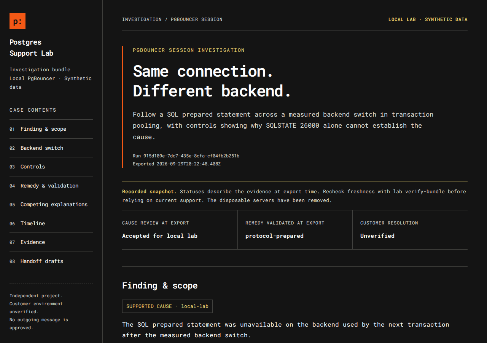
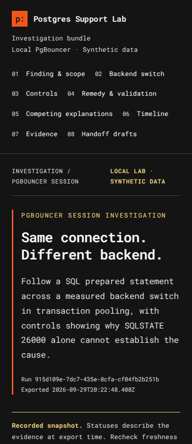

# Example: reviewed PgBouncer investigation

This folder holds one complete, unedited support bundle from the PgBouncer lab. It follows a SQL prepared statement as PgBouncer switches the next transaction to a different PostgreSQL server connection, then through a recorded cause review, a separate choice of fix, a local check of that fix, and draft messages for the customer and engineering.

## Read it

| Start here | What it is |
|---|---|
| [Customer reply draft](bundle/customer-reply.md) | What the customer would be told, and what we still need from them |
| [Engineering handoff draft](bundle/engineering-escalation.md) | Baseline, backend switch, controls, remedy evidence, competing explanations and references |
| [Validation record](bundle/resolution-validation.md) | Checks for the selected remedy against retained observations |
| [Case summary](bundle/case-summary.md) | Status at export, selected remedy and scope |
| [Runbook candidate](bundle/runbook-candidate.md) | Draft troubleshooting guide, not yet reviewed for publication |
| `bundle/support-bundle.html` | The full styled report. GitHub shows it as source, so download it or see the screenshots below |

## How it was produced

On 29 September 2026, on Linux with PostgreSQL 16.13 and PgBouncer 1.22.0, running as a regular (non-root) user:

1. `npm run demo:pooling -- --approve-lab` started disposable PostgreSQL and PgBouncer processes on private Unix sockets, recorded nine observations and removed both servers. Evidence was collected at 20:07 UTC.
2. `pooling compare` showed the comparison. The backend switch, the controls and the proposed cause were explained to Angie in plain language.
3. Angie gave her cause decision. It was recorded unchanged with `pooling review` at 20:14 UTC, after confirming the evidence and comparison were current:

   > Decision: accept. "Based on the comparison you presented, the evidence supports the proposed cause in this local reproduction. The prepared statement worked across transactions on the same direct backend. Through PgBouncer, execution failed with 26000 after the measured switch to a different backend. The direct reset control produced the same error, which shows why the error code alone would not establish the cause. This acceptance is limited to the tested local workflow and does not establish a customer's cause or select a remedy."

4. Both remedies and the limits of the evidence were then explained. Angie selected a remedy separately. It was recorded at 20:22 UTC, bound to the accepted cause record:

   > Remedy: protocol-prepared. "I want to validate the approach that allows the prepared statement to work across transactions when the pool assigns a different backend. The driver's named prepared statements and the pooler's prepared-statement support address that workflow. My selection applies only to the tested local workflow. Performance, statement eviction and managed-platform compatibility remain untested."

   The reviewer name is caller-supplied. The tool has no sign-in, so the record shows who was named, not an authenticated identity.
5. `pooling validate`, `pooling export` and `lab verify-bundle` produced and checked this bundle.

## What it shows

| Step | Endpoint | Backend | Result |
|---|---|---|---|
| Prepare and execute | direct | 4139 | success, count 1 |
| Execute in the next transaction | direct | 4139 | success, count 1 |
| Prepare and execute | pooled | 4140 | success, count 1 |
| Execute in the next transaction, 4140 held by another client | pooled | 4141 | `26000` |
| Control: execute after `DEALLOCATE ALL` | direct | 4139 | `26000` |
| Control: bounded statement timeout | direct | 4139 | `57014` |
| Remedy: prepare, execute and deallocate in one transaction | pooled | 4140 | success, count 1 |
| Remedy: driver named prepared statement, first transaction | pooled | 4140 | success, count 1 |
| Remedy: driver named prepared statement, next transaction, 4140 held | pooled | 4141 | success, count 1 |

Backend numbers are process IDs from this run. The pool ran in transaction mode with `max_prepared_statements=10`. The validated remedy, `protocol-prepared`, succeeded both before and after the measured backend switch under that setting.

## Scope

- **Local only.** The accepted cause and `RESOLUTION_VALIDATED` apply to this synthetic experiment and to the selected remedy. Customer resolution is unset.
- **Retained evidence.** Validation read observations recorded during the completed run. It made no new database connection.
- **Untested:** performance, prepared-statement eviction, other session features such as `SET` or temporary tables, and managed-platform behavior.
- **Drafts, not sent messages.** Communication approval is pending.

## Historical validity

Evidence is fresh for one hour. This run's window ended at `2026-09-29T21:07:28.650Z`. Nothing in the bundle has been edited to look current.

The verifier reports `validationAtExport: RESOLUTION_VALIDATED`, which is fixed at export. `currentEvidenceStatus` read `RESOLUTION_VALIDATED` inside the window and reads `VALIDATION_BLOCKED` after it. `integrity` stays `VALID` as long as the files are unchanged.

## Verify it yourself

From the repository root, with Node.js 24:

```sh
node src/cli.ts lab verify-bundle examples/pooling-case/bundle b5bf2ed591a54d49b55a208038d6687e6d3f354037ccb545fbec0ceadea6505c
```

The hash is the manifest hash printed at export. The verifier rejects any added, missing or changed file inside `bundle/`, and rebuilds every output from the captured sources to check that drafts, findings and validation agree with the evidence.

## Report version

This bundle uses the first pooling bundle version, `0.1.0-pooling-bundle1`, so its report keeps the original heading and customer-reply wording. New exports use `0.1.0-pooling-bundle2`, which has a plain-language heading and a clearer sentence about the validated fix. PgBouncer bundles can't be restyled yet, so this example stays as it was exported.

## Screenshots

Desktop, 1280px wide:



Phone width, 390px. An automated check with every evidence section expanded found no clipped or off-screen content at this width:



Print layout was not checked.
