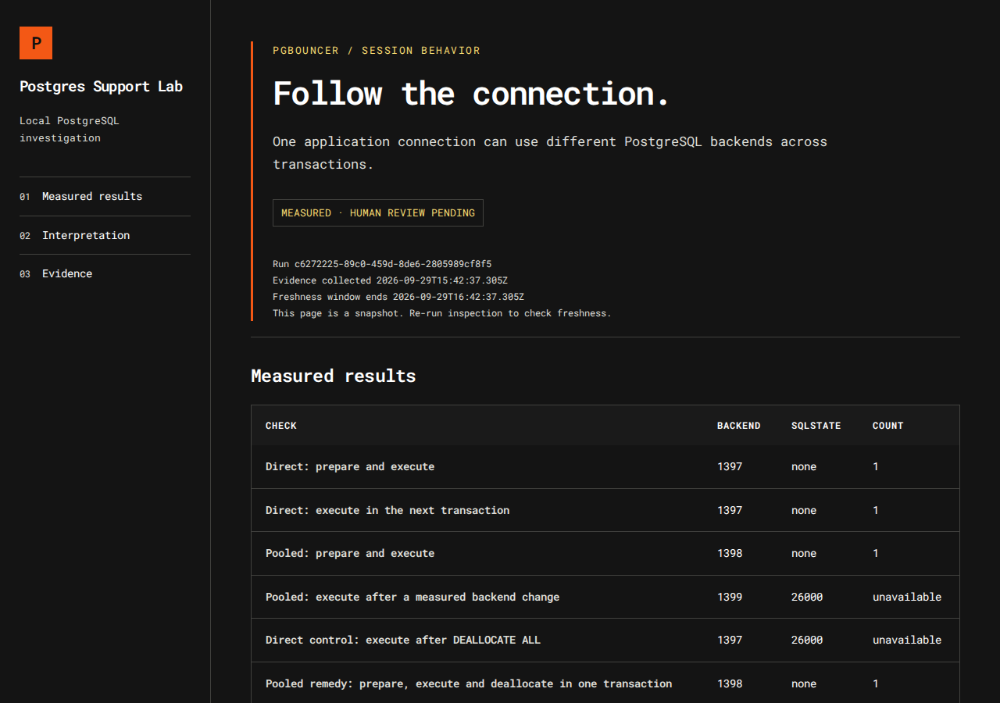
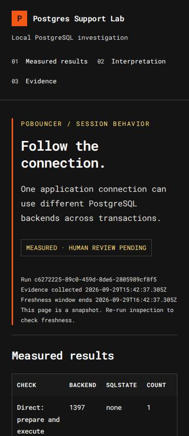
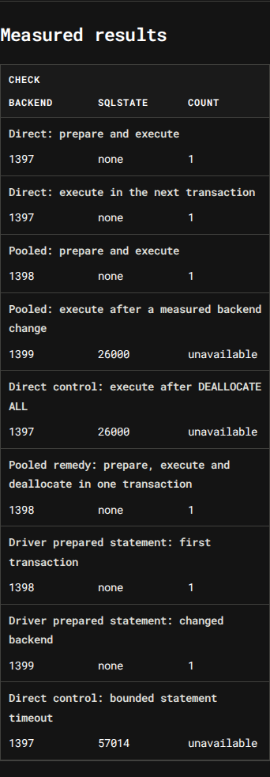

# Example: PgBouncer prepared-statement experiment

This folder holds one unedited run of the PgBouncer experiment, from before the review and export steps existed. It was produced with `npm run demo:pooling -- --approve-lab` on 29 September 2026, on Linux with PostgreSQL 16.13 and PgBouncer 1.22.0, running as a regular (non-root) user. The data is synthetic and both servers were disposable local processes on private Unix sockets with TCP disabled.

Open [`run/pooling-report.md`](run/pooling-report.md) for the readable report. The styled version is `run/pooling-report.html`; GitHub shows HTML files as source, so download it or see the screenshots below.

## The support question

A developer says the app connects fine, but one step fails. The experiment asks one narrow question: is a statement prepared with SQL `PREPARE` still available when PgBouncer, in transaction mode, runs the next transaction on a different PostgreSQL server connection? Those server connections are sometimes called backends, and the tables below use that word.

## Measured results

| Check | Backend | SQLSTATE | Count |
|---|---|---|---|
| Direct: prepare and execute | 1397 | none | 1 |
| Direct: execute in the next transaction | 1397 | none | 1 |
| Pooled: prepare and execute | 1398 | none | 1 |
| Pooled: execute after a measured backend change | 1399 | 26000 | unavailable |
| Direct control: execute after DEALLOCATE ALL | 1397 | 26000 | unavailable |
| Pooled remedy: prepare, execute and deallocate in one transaction | 1398 | none | 1 |
| Driver prepared statement: first transaction | 1398 | none | 1 |
| Driver prepared statement: changed backend | 1399 | none | 1 |
| Direct control: bounded statement timeout | 1397 | 57014 | unavailable |

Backend numbers are process IDs from this run. They show which server connection handled each step and change on every run.

## What the controls show

- **Direct baseline.** On a direct connection the prepared statement survives into the next transaction on the same backend.
- **Measured backend change.** Through the pool, a second client holds the original backend, so the next transaction lands on backend 1399. `EXECUTE` fails with `26000` (prepared statement does not exist).
- **Same error without a pool.** `DEALLOCATE ALL` on a direct connection produces the same `26000`. The error code alone therefore cannot tell you the connection mode or the cause.
- **Different failure, different code.** A statement timeout gives `57014`, so a timeout would not be mistaken for this problem.
- **Two workable remedies.** Keeping prepare, execute and deallocate inside one transaction works through the pool. Driver-level (protocol) named prepared statements also worked across the backend change with `max_prepared_statements=10`.

Which remedy fits depends on the application's workflow. The experiment does not choose one, and it does not show that all prepared statements or all DDL fail through PgBouncer.

## Historical validity

Evidence in this lab is fresh for one hour after collection. This run was collected at `2026-09-29T15:42:37.305Z` and its window ended at `2026-09-29T16:42:37.305Z`. Nothing here has been edited to look current.

Inspection separates the two questions:

- `integrity` checks that the run file and probe catalog still match the manifest. It stays `VALID` for these unchanged files.
- `evidenceStatus` reports freshness at the time you run inspection. It read `MEASURED` inside the window and reads `STALE` after it, which is expected for a historical example.

## Verify it yourself

From the repository root, with Node.js 24:

```sh
npm run demo:pooling -- inspect examples/pooling-run/run dbf6cc33d93bc3aa35e6b5ea5ba917bac93a6d08adffab826fe1ad5851a455bf
```

That hash is the manifest hash printed when the run finished. Passing it checks the files against that recorded value (`anchorChecked: true`).

Files in `run/`:

| File | Purpose | Covered by manifest |
|---|---|---|
| `pooling-manifest.json` | Hashes of the run and probe catalog | Anchor |
| `pooling-run.json` | Versioned measured observations | Yes |
| `pooling-probes.json` | Fixed SQL probe catalog | Yes |
| `pooling-plan.json` | Approved plan and operations | No |
| `pooling-report.md`, `pooling-report.html` | Readable views generated from the run | No |

## Current limits

- This folder is a version-one run recorded before pooling review existed, and it is kept unedited. Its evidence has expired, so it cannot receive a new review. See [`examples/pooling-case/`](../pooling-case/README.md) for a reviewed pooling bundle.
- This is a local experiment. It does not test a PlanetScale branch or any managed pool.
- This folder's `pooling-report.html` keeps the layout it was exported with. At phone width (390px) its table is wider than its container, so the last column is reached by scrolling the table sideways. Reports from newer runs fix this: below 480px each check gets its own line, with its backend, SQLSTATE and count in aligned columns underneath. The desktop layout is unchanged.

## Screenshots

Desktop, 1280px wide:



Phone width, 390px, as exported:



The same run's data rendered with the current report code, results table at 390px. This image was made from a new rendering of `pooling-run.json`; the committed HTML file was not changed.


