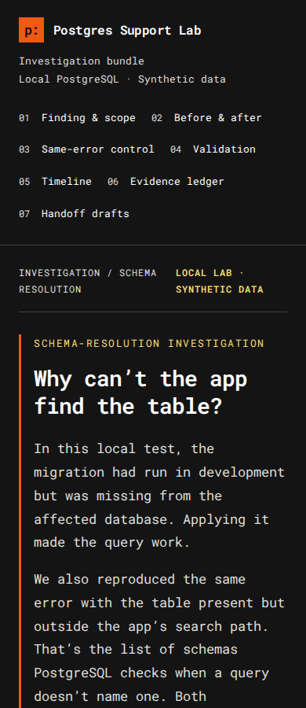
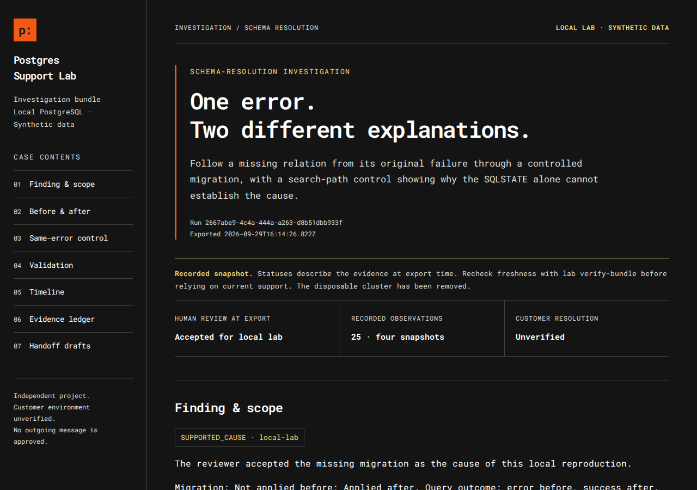
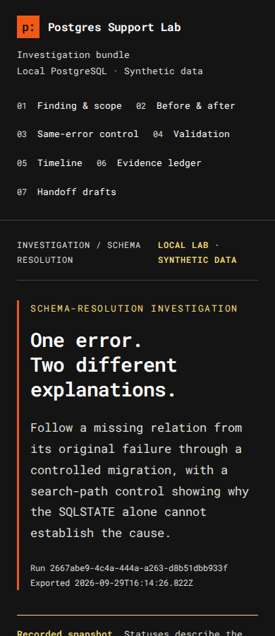

# Example: completed schema investigation

This folder holds one complete, unedited support bundle from the missing-table lab. It follows a "relation does not exist" error from the local reproduction through a person's review, a local check of the fix, and draft messages for the customer and engineering.

## Read it

| Start here | What it is |
|---|---|
| [Customer reply draft](bundle/customer-reply.md) | What the customer would be told, and what we still need from them |
| [Engineering handoff draft](bundle/engineering-escalation.md) | Changed and unchanged facts, the alternative explanation and evidence references |
| [Case summary](bundle/case-summary.md) | Status at export, scope and what remains unknown |
| [Runbook candidate](bundle/runbook-candidate.md) | Draft troubleshooting guide, not yet reviewed for publication |
| `bundle/support-bundle.html` | The full styled report. GitHub shows it as source, so download it or see the screenshots below |

## How it was produced

On 29 September 2026, on Linux with PostgreSQL 16.13, running as a regular (non-root) user:

1. `npm run demo:postgres -- --approve-lab` created a disposable cluster with synthetic data, recorded four snapshots and removed the cluster. Evidence was collected at 15:57 UTC.
2. `lab compare` showed the comparison. The candidate cause was explained to Angie in plain language, including the search-path control and limitations.
3. Angie gave her decision and rationale. They were recorded unchanged with `lab review` at 16:14 UTC, while the evidence was still current:

   > Decision: accept. "Based on the comparison you showed me, the evidence supports missing migration as the cause in this local reproduction. The table was absent before the migration, and the same query worked afterwards with the database, role and search path unchanged. The search-path control also shows why the error code alone would not be enough. This acceptance applies only to the local lab; customer resolution and communication approval remain pending."

   The reviewer name is caller-supplied. The tool has no sign-in, so the record shows who was named, not an authenticated identity.
4. `lab validate`, `lab export` and `lab verify-bundle` produced and checked this bundle.

## What it shows

| Snapshot | Migration | Table exists | Query |
|---|---|---|---|
| Development | applied | yes | success |
| Affected, before | absent | no | `42P01` |
| Search-path control | applied | yes, outside the search path | `42P01`; schema-qualified query returns 1 row |
| Affected, after | applied | yes | success, 1 row |

Between "before" and "after", the target, role, direct connection, query, search path (`app_data, public`) and schema `USAGE` stayed the same. The search-path control produces the same error with the table present, which is why the error code alone cannot establish the cause.

## Scope

- **Local only.** The accepted cause and `RESOLUTION_VALIDATED` apply to this synthetic reproduction. Customer resolution is unset.
- **Drafts, not sent messages.** Customer and engineering texts are drafts. Communication approval is pending.
- **Alternatives not yet reproduced separately:** wrong branch or target, and identifier capitalization.

## Historical validity

Lab evidence is fresh for one hour. This run's window ended at `2026-09-29T16:57:31.257Z`. Nothing in the bundle has been edited to look current.

The verifier reports two separate answers:

- `validationAtExport`: `RESOLUTION_VALIDATED`. What the evidence supported when exported. This does not change.
- `currentEvidenceStatus`: whether the evidence still supports validation when you run the verifier. It read `RESOLUTION_VALIDATED` inside the window and reads `VALIDATION_BLOCKED` after it. `integrity` stays `VALID` as long as the files are unchanged.

## Verify it yourself

From the repository root, with Node.js 24:

```sh
node src/cli.ts lab verify-bundle examples/schema-case/bundle c16380e3d30d3e846218772b8bfeaf11ced3c9f9e3b1867e96af4b55295720fc
```

The hash is the manifest hash printed at export. Passing it checks the bundle against that recorded value (`anchorChecked: true`). The verifier also rejects any added, missing or changed file inside `bundle/`, so keep notes like this README outside it.

## Restyled copy

`bundle-restyled/` is the same bundle with the current report design (bundle version 4). It was made on 1 October 2026 with:

```sh
node src/cli.ts lab restyle-bundle examples/schema-case/bundle examples/schema-case/bundle-restyled c16380e3d30d3e846218772b8bfeaf11ced3c9f9e3b1867e96af4b55295720fc
```

Restyling changes only the HTML report and the manifest. The evidence, review history, drafts and original export time (`2026-09-29T16:14:26.822Z`) are copied unchanged, and the new manifest records the original manifest hash. Restyling doesn't make the evidence current again: the verifier still reports `currentEvidenceStatus: VALIDATION_BLOCKED`. The drafts keep their original wording, because the plain-language customer reply only applies to new exports.

To check it:

```sh
node src/cli.ts lab verify-bundle examples/schema-case/bundle-restyled a88c90245332cf5c7c1cfc9fd9f9211d43e4f90898a5ddfa7ab043cbbc9dde14
```

That checks the restyled copy against its own manifest. To check the original evidence, verify `bundle/` with its hash as shown above.

Restyled report, desktop and phone width:




## Screenshots of the original bundle

Desktop, 1280px wide:



Phone width, 390px. An automated check with every evidence section expanded found no clipped or off-screen content at this width:



Print layout was not checked.
